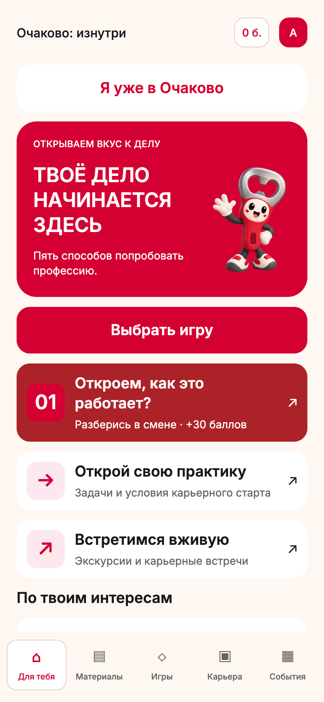
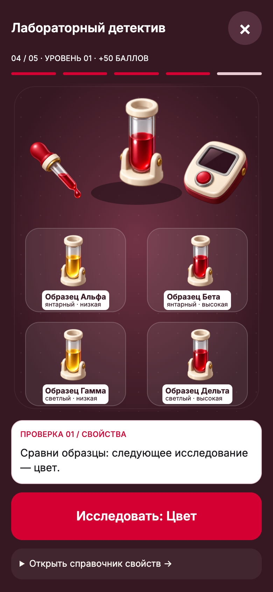
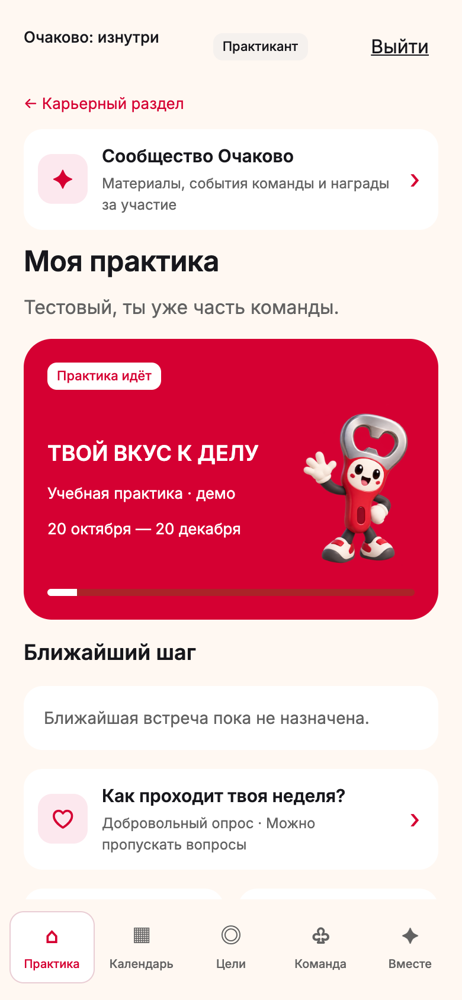
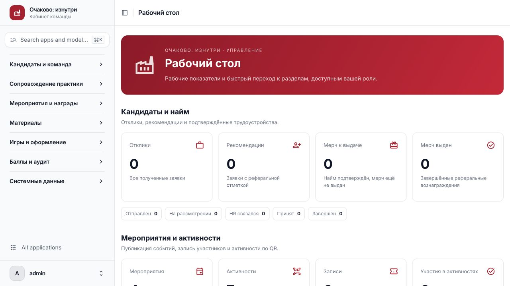
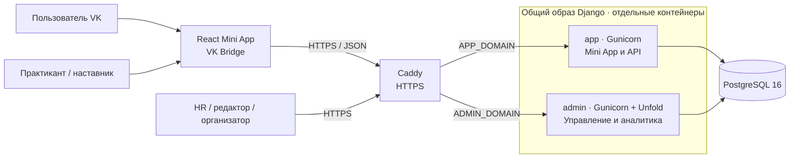

# Очаково: изнутри

**Открываем вкус к делу.** Цифровая платформа внешнего и внутреннего HR-бренда: знакомит молодёжь с производством через игры и истории команды, принимает отклики и сопровождает практику. Мини-приложение во VK объединено с кабинетами практиканта и наставника и административной панелью.

Для предприятия это единый путь от первого знакомства до работы в команде: отклики и их статусы, сопровождение практикантов, мероприятия и рекомендации сотрудников доступны в одной системе.

[Открыть во VK](https://vk.com/app54850900) · [Административная панель](https://admin-ochakovo.45-132-179-9.sslip.io/) · [Локальный запуск](docs/development.md) · [Развёртывание](docs/vk-deployment.md)

## Посмотреть продукт

| Знакомство с компанией | Проба профессии | Сопровождение практики |
|:---:|:---:|:---:|
|  |  |  |

Административная панель — рабочий стол команды

Скриншоты демонстрационного наполнения. В админке доступны показатели, редакторы и HR-операции в соответствии с правами пользователя.

## Что умеет система

| Направление | Возможности |
|---|---|
| **Знакомство и карьера** | Вход через VK, профиль 18+, выбор интересов, предложения практики и работы с условиями и фильтрами. Отклик с сохранением анкеты на момент отправки, история и статусы. Играть перед откликом необязательно. |
| **Игры о профессиях** | Пять игровых механик: автоматизация «Сигнал → действие», механика «Передай движение», «Лабораторный детектив», логистика «Собери и доставь», расследование «Разберись в смене». Уровни, подсказки, сохранение прогресса и серверная проверка решений. |
| **Материалы и тесты** | История предприятия, люди и производство; текст, изображения и видео, тесты по материалам с пояснениями и баллами. В том числе историческая викторина «Открываем историю». Публичные и внутренние материалы. |
| **Мероприятия и награды** | Календарь, запись и отмена с учётом мест, активности по QR. Баланс, история начислений, выбор цели и обмен баллов на мерч с учётом остатков. Повторное прохождение не дублирует награду. |
| **Практика и наставничество** | План адаптации, цели и проверка результатов, календарь и встречи, вопросы наставнику и координатору, обратная связь, добровольные опросы и итог практики. Наставник работает со своими назначенными практикантами. |
| **Внутренний HR-бренд** | Сообщество сотрудников: внутренние материалы и мероприятия, участие в активностях и награды. Реферальный код практиканта связывает рекомендацию с откликом; после подтверждённого HR найма возникает право на мерч. |
| **Работа HR и аналитика** | Анкеты и отклики, смена статусов, подтверждение найма, экспорт CSV, назначение наставников, аккаунты сотрудников и учёт выдачи мерча. Рабочий стол с показателями найма, мероприятий и участия. Разграничение прав и журнал действий. |
| **Управление содержимым** | Редакторы материалов, тестов, вакансий, событий, наград и игровых уровней. Черновики, предпросмотр, публикация и сравнение версий. Конструкторы шести механик, включая исторический тест: новые сценарии используют готовые правила и графические модули; новая механика требует разработки. |

Стенд использует демонстрационные вакансии, события и награды. Отклики сохраняются и видны в админке; интеграция с внешней кадровой системой не подключена. Игры знакомят с рабочими задачами и не определяют решение о найме.

## User stories

| Кто | Что хочет сделать и зачем | Путь в продукте |
|---|---|---|
| **Студент** | «Хочу попробовать задачи профессии и понять условия, чтобы осознанно выбрать практику». | VK → игра или материал → предложение → анкета → отклик. Можно сразу перейти к предложениям. |
| **Практикант** | «Хочу понимать свой следующий шаг и получать обратную связь, чтобы освоиться в команде». | «Я уже в Очаково» → план и цели → встреча с наставником → результат и отзыв. |
| **Наставник** | «Хочу видеть цели своих практикантов и проверять результаты в одном месте». | Вход → назначенные практиканты → проверка цели → обратная связь и следующая встреча. |
| **HR / координатор** | «Хочу вести кандидата от отклика до практики и видеть результат рекомендаций». | Админка → отклики и статусы → назначение практики и наставника → подтверждение найма и выдача мерча. |
| **Редактор / организатор** | «Хочу обновлять программу без обращения к разработчику». | Админка → материал, тест, уровень или событие → предпросмотр и публикация; для активности — QR. |

## Демо-доступ

| Роль | Где войти | Логин | Пароль |
|---|---|---|---|
| Обычный пользователь | [VK Mini App](https://vk.com/app54850900) | Свой аккаунт VK | Отдельный пароль приложения не нужен |
| Практикант | В мини-приложении: **«Я уже в Очаково»** | `intern.demo` | `Start-Otkryvashka-26!` |
| Руководитель / наставник | Там же, **«Я уже в Очаково»** | `mentor.demo` | `Team-Otkryvashka-26!` |
| Администратор | [Административная панель](https://admin-ochakovo.45-132-179-9.sslip.io/) | `admin` | `master-otkryvashka` |

Это тестовые аккаунты стенда. Кабинет практиканта или наставника открывается по назначенной роли; доступ в админку отдельный.

## Стек и архитектура

| Слой | Технологии |
|---|---|
| Мини-приложение | React 19, TypeScript, Vite 6, CSS, Inter; VK Bridge для интеграции с VK |
| API и административная панель | Python, Django 5.2 LTS, Django Unfold, Gunicorn |
| Данные | PostgreSQL 16, Django ORM и миграции; транзакции для баллов, записей и наград |
| QR | ZXing и сканер VK для чтения; Python `qrcode` для генерации в админке |
| Развёртывание | Docker Compose, Caddy 2, HTTPS, постоянные volumes |

Мини-приложение с API и админка запускаются в отдельных контейнерах из общего Django-образа. Caddy разделяет их по HTTPS-доменам; оба сервиса работают с общей PostgreSQL. Сервер проверяет подпись запуска VK, роли и игровые решения. Опубликованные материалы, уровни, медиа и прогресс хранятся в PostgreSQL; приватные ответы не передаются клиенту. У сотрудников отдельные сессии, у администраторов — права Django.

## Запуск и документация

[Локальный запуск и проверки](docs/development.md) · [Развёртывание, VK и резервные копии](docs/vk-deployment.md)

[API](docs/backend.md) · [Админка и роли](docs/django-admin.md) · [Редакторы контента](docs/content-admin.md) · [Сущности](docs/admin-entities.md) · [Игры](docs/games.md) · [Уровни](docs/game-levels.md) · [Материалы](docs/materials.md) · [Практика](docs/practice.md) · [Рекомендации](docs/referrals.md)
